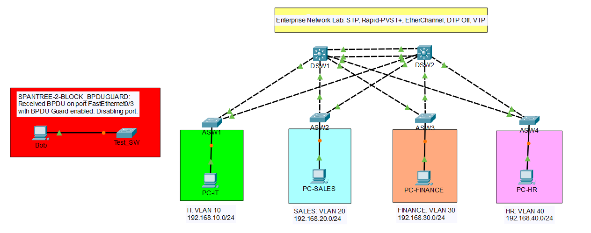

# Enterprise Network Lab: Rapid-PVST+, EtherChannel, DTP Off, VTP

A two-tier (distribution + access) enterprise campus network for **Cisco Packet Tracer** that simulates:

- **Rapid-PVST+** with per-VLAN root placement (load balancing)
- **EtherChannel (LACP)** between the distribution switches
- **DTP disabled** on every trunk and access port
- **VTP v2** (DSW1 = server, everything else = client)
- **HSRP v2** gateways aligned with the STP root
- **PortFast + BPDU Guard** on edge ports

## Topology



```
               DSW1 ==Po1(LACP)== DSW2
              / | | \          / | | \
          ASW1 ASW2 ASW3 ASW4 (each ASW dual-homed to DSW1 and DSW2)
            |    |    |    |
         PC-IT SALES FINANCE HR
```

| Tier         | Devices            | Model (Packet Tracer) |
|--------------|--------------------|-----------------------|
| Distribution | DSW1, DSW2         | 3560-24PS / 3650-24PS |
| Access       | ASW1, ASW2, ASW3, ASW4 | 2960-24TT         |
| End devices  | PC-IT, PC-SALES, PC-FINANCE, PC-HR | PC |

## Design at a glance

| Feature | Value |
|---|---|
| VLANs | 10 IT, 20 SALES, 30 FINANCE, 40 HR, 99 MGMT (native), 999 BLACKHOLE |
| VTP | Domain `ENTERPRISE`, v2, password `Cisco123`; DSW1 server, others client |
| STP mode | `rapid-pvst` |
| Root bridges | DSW1: VLAN 10,20 (4096) / DSW2: VLAN 30,40 (4096) |
| EtherChannel | DSW1-DSW2 Po1, LACP active/active, Fa0/23-24 |
| DTP | `switchport nonegotiate` on trunks, fixed `access` on edge ports |
| First hop redundancy | HSRP v2, active router matches STP root per VLAN |

## Repository layout

```
enterprise-stp-lab/
├── README.md
├── LICENSE
├── .gitignore
├── docs/
│   ├── 01-design-overview.md
│   ├── 02-addressing-plan.md
│   ├── 03-link-map.md
│   ├── 04-apply-order.md
│   └── images/
│       └── topology.png
├── configs/
│   ├── DSW1.txt
│   ├── DSW2.txt
│   ├── ASW1.txt
│   ├── ASW2.txt
│   ├── ASW3.txt
│   ├── ASW4.txt
│   └── post-vtp-sync.txt
├── verification/
│   └── verification-commands.md
├── labs/
│   └── stp-etherchannel-exercises.md
├── evidence/                 <- proof: test sheets + screenshots
│   ├── README.md
│   ├── TEST-REPORT.md
│   ├── running-configs/
│   ├── 00-baseline-topology-cabling/
│   ├── 01-vtp-sync/
│   ├── 02-trunks-dtp-disabled/
│   ├── 03-etherchannel-lacp/
│   ├── 04-stp-root-election/
│   ├── 05-hsrp-inter-vlan/
│   ├── 06-test-rapid-convergence/
│   ├── 07-test-etherchannel-failure/
│   ├── 08-test-bpdu-guard/
│   ├── 09-test-root-hijack-root-guard/
│       (each folder has README.md test sheet + screenshots/)
└── packet-tracer/
    └── .gitkeep  spanning-tree-protocol-lab.pkt 
```

## Quick start

1. Build the topology in Packet Tracer using [docs/03-link-map.md](docs/03-link-map.md).
2. Paste the configs in the order given in [docs/04-apply-order.md](docs/04-apply-order.md).
3. Wait about a minute for VTP to sync, then paste [configs/post-vtp-sync.txt](configs/post-vtp-sync.txt) sections.
4. Check everything with [verification/verification-commands.md](verification/verification-commands.md).
5. Run the exercises in [labs/stp-etherchannel-exercises.md](labs/stp-etherchannel-exercises.md).
6. Record proof: follow [evidence/README.md](evidence/README.md), save screenshots per test, and update [evidence/TEST-REPORT.md](evidence/TEST-REPORT.md).

## Evidence

Each feature and test has its own folder under [evidence/](evidence/) with a test sheet and a `screenshots/` folder.
The sheet lists the exact screenshot file names to save, the commands to run and the expected result.
The master status table is in [evidence/TEST-REPORT.md](evidence/TEST-REPORT.md).

## Notes

- Passwords here are lab values only. Never reuse them in production.
- VTP syncs only over trunks, and only when domain and password match.

## License

MIT, see [LICENSE](LICENSE).
