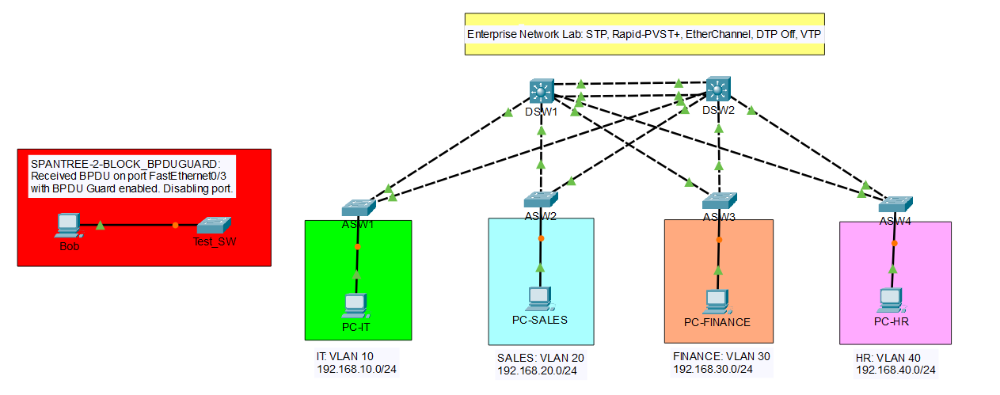

# 03 - Link Map

Use straight-through copper cables between switches in Packet Tracer
(switch to switch auto-MDIX handles it). Connect the PCs to Fa0/10 on each
access switch.

## Distribution to distribution (Port-channel 1)

| From | To |
|---|---|
| DSW1 Fa0/23 | DSW2 Fa0/23 |
| DSW1 Fa0/24 | DSW2 Fa0/24 |

## Distribution to access

| Access switch | Uplink Fa0/1 goes to | Uplink Fa0/2 goes to |
|---|---|---|
| ASW1 | DSW1 Fa0/2 | DSW2 Fa0/2 |
| ASW2 | DSW1 Fa0/3 | DSW2 Fa0/3 |
| ASW3 | DSW1 Fa0/4 | DSW2 Fa0/4 |
| ASW4 | DSW1 Fa0/5 | DSW2 Fa0/5 |

DSW1 Fa0/1 and DSW2 Fa0/1 are not used (shut down, VLAN 999).

## Access to end devices

| Switch port | Device |
|---|---|
| ASW1 Fa0/10 | PC-IT |
| ASW2 Fa0/10 | PC-SALES |
| ASW3 Fa0/10 | PC-FINANCE |
| ASW4 Fa0/10 | PC-HR |

## Device models

- DSW1, DSW2: Cisco 3560-24PS (or 3650-24PS). They need Layer 3 for SVIs and HSRP.
- ASW1-ASW4: Cisco 2960-24TT.
- PCs: generic PC.

## Topology image

`images/topology.png` is your original screenshot. It still shows a CSW switch
that this lab does not use. Take a new screenshot of your finished topology
(without CSW) and save it over `images/topology.png`.

